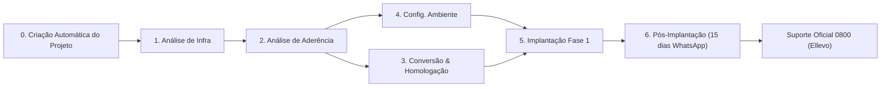
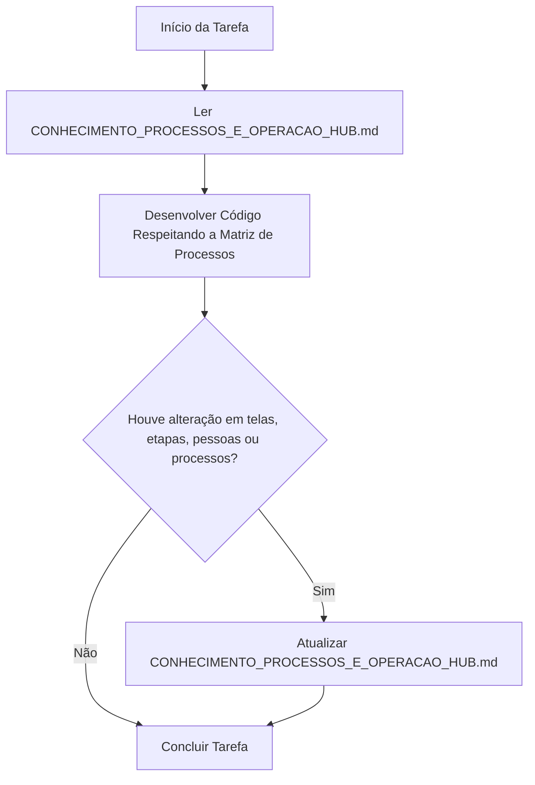

# 🏛️ Conhecimento Mestre: Processos Operacionais e Prática do Siplan HUB

> **Fonte Única da Verdade para Desenvolvedores e Agentes de IA (Codex, Antigravity, Gemini, Claude, Cursor)**  
> *Versão:* 1.2.0 — *Atualizado em:* 2026-11-11  
> *Status:* **Documento Permanente e Auto-Alimentável**

---

## 📑 Sumário

1. [Propósito e Instruções Obrigatórias para IAs](#1-propósito-e-instruções-obrigatórias-para-ias)
2. [O Ciclo de Vida da Implantação de Cartórios (Etapas 1 a 6)](#2-o-ciclo-de-vida-da-implantação-de-cartórios-etapas-1-a-6)
3. [Janelas Temporais Inflexíveis e Dinâmica de Viagens](#3-janelas-temporais-inflexíveis-e-dinâmica-de-viagens)
4. [Mapeamento de Equipes, Pessoas e Especialidades (Matriz RACI)](#4-mapeamento-de-equipes-pessoas-e-especialidades-matriz-raci)
5. [Tabela de Colaboradores e Especialidades de SD (Service Desk)](#5-tabela-de-colaboradores-e-especialidades-de-sd-service-desk)
6. [Módulos Especiais: Modelos OrionTN, Produtos Secundários e Bloqueios Comerciais](#6-módulos-especiais-modelos-oriontn-produtos-secundários-e-bloqueios-comerciais)
7. [CS/CX, Pesquisa NPS e Termômetro Pós-Implantação](#7-cscx-pesquisa-nps-e-termômetro-pós-implantação)
8. [Matriz Detalhada: Telas, Ações no HUB e Ações Externas](#8-matriz-detalhada-telas-ações-no-hub-e-ações-externas)
9. [Regras de Férias e Gestão de Banco de Horas](#9-regras-de-férias-e-gestão-de-banco-de-horas)
10. [Integração com a Telemetria Invisível de Afinidade](#10-integração-com-a-telemetria-invisível-de-afinidade)
11. [Invariantes e Regras de Ouro de Negócio](#11-invariantes-e-regras-de-ouro-de-negócio)
12. [Protocolo Oficial de Manutenção e Auto-Alimentação por IAs](#12-protocolo-oficial-de-manutenção-e-auto-alimentação-por-ias)
13. [Base de Conhecimento Operacional e IA do Orion TN (Suporte Ellevo/0800)](#13-base-de-conhecimento-operacional-e-ia-do-orion-tn-suporte-ellevo0800)

---

## 1. Propósito e Instruções Obrigatórias para IAs

Este documento consolida o funcionamento **real, prático e diário** dos processos operacionais do Siplan HUB, integrando o comportamento dos colaboradores nas telas do sistema com as interações externas essenciais (e-mails formais com cópia, grupos de WhatsApp, chamados no Ellevo 0800 e planilhas administrativas).

### ⚠️ Regra Mestre de Consulta Obrigatória
Toda IA atuando neste repositório deve **consultar este documento antes de supor premissas** sobre:
- Quem é responsável por qual etapa ou sistema.
- Como ocorrem as transições entre etapas.
- Em quais telas cada ação é realizada.
- Quais comunicações devem ser mantidas via e-mail ou WhatsApp.
- Limitações de automação (o que pode e o que **não pode** ser automatizado).

### 🔄 Regra Mestre de Auto-Alimentação
Sempre que uma IA ou desenvolvedor:
1. Criar ou alterar uma tela ou rota;
2. Modificar um formulário de etapa ou adicionar campos de processo;
3. Ajustar regras de transição automática de status;
4. Identificar novos responsáveis ou redistribuição de tarefas entre analistas;
5. Alterar regras de integração com ferramentas de terceiros (Ellevo, e-mail, WhatsApp);

**Deverá obrigatoriamente atualizar este arquivo** (`docs/CONHECIMENTO_PROCESSOS_E_OPERACAO_HUB.md`) refletindo a nova realidade operacional.

---

## 2. O Ciclo de Vida da Implantação de Cartórios (Etapas 1 a 6)

O core business do Siplan HUB é a implantação de softwares de automação cartorária (Orion Notas, Orion Protesto, Orion Registro de Imóveis, RCPN, RTDPJ, etc.). O fluxo é dividido em 6 estágios sequenciais e interdependentes:



### Detalhamento das Etapas:

#### Etapa 0: Criação do Projeto
* **Processo:** Quase **100% automatizado**. Uma automação monitora a entrada de novos contratos/chamados no Ellevo e cria o projeto automaticamente no Supabase, sincronizando inclusive chamados de produtos secundários.
* **Uso Manual:** O botão `+ Novo Projeto` na tela `/projects` existe como contingência para casos atípicos ou testes.

#### Etapa 1: Análise de Infraestrutura
* **Objetivo:** Auditar servidores, estações, rede local, internet, bancos de dados existentes e acessos remotos (AnyDesk/RDP).
* **Operadores Principais:** Alex Silva e Bruno Fernandes.
* **Telas:** `/projects` (Aba Análise de Infraestrutura) e formulário público `/public/infra-coleta/:id`.
* **Fluxo de Coleta:** Alex ou Bruno enviam o link `/public/infra-coleta/:id` diretamente ao responsável de TI do cartório com instruções formais de preenchimento.
* **Automação de Retorno:** Assim que o TI do cartório conclui e envia o formulário, uma automação interna dispara um e-mail com o sumário completo de infraestrutura para o gestor e a diretoria, com Alex Silva e Bruno Fernandes em cópia.
* **Tratativa de Impeditivos:** Quando o cartório não atende aos requisitos mínimos, o card é sinalizado como bloqueio comercial em `/commercial/blockers`. O Comercial negocia com o cliente. Após resolução, o gestor atualiza manualmente a etapa em `/projects`.

#### Etapa 2: Análise de Aderência
* **Objetivo:** Confrontar as rotinas cartorárias e minutas do cliente com os recursos do sistema Orion contratado.
* **Operadores Principais:** Implantadores seniores por especialidade (Julio Araujo para REG, Rodrigo Brites/Rodrigo Mizuno para PRO, Ricardo Vieira/Rodrigo Brites para TN; pontualmente Erik Marques).
* **Telas:** `/implantadores/aderencia`, `/implantadores/aderencia/:systemType`, `/projects` (Aba Aderência).
* **Tratativa de Lacunas/Impasses:** Se um requisito operacional essencial não puder ser atendido nativamente, a solicitação é encaminhada formalmente para a equipe de **Produtos & Desenvolvimento**. O projeto é colocado em pausa/espera até o posicionamento técnico e cronograma de liberação da funcionalidade.
* **Entregável:** Parecer técnico formal com gravação de rascunho automático, auxílio de IA e exportação em PDF A4 padrão `@react-pdf/renderer`.

#### Etapa 4: Configuração e Preparação de Ambiente
* **Objetivo:** Instalação de SO, SQL Server/PostgreSQL, instâncias Orion, certificados digitais e rotinas de backup.
* **Operadores Principais:** Alex Silva e Bruno Fernandes.
* **Telas:** `/deployments/environment-config` (Kanban operacional) e `/projects` (Aba Preparação de Ambiente).
* **Configuração no Orion Admin (Chaves via Orion CRM):** Quando a serventia contrata produtos dependentes do Orion Admin (Livro Caixa Web - LCW, SGA ou Cartório On Hand), Alex Silva ou Bruno Fernandes geram as chaves e credenciais de integração na plataforma **Orion CRM** via CNS da serventia e realizam a configuração/parametrização direta no servidor da serventia (VM e containers) através das propriedades (`urlAdminCentral`, `usuarioAdminCentral`, `senhaAdminCentral`). Essa etapa deve estar concluída a tempo para que o implantador consiga realizar a homologação e treinamento desses produtos.
* **Regra de Conclusão:** Ao mover o card para "Concluídos" no Kanban, o sistema conclui automaticamente a Etapa 4 no projeto. O ambiente deve estar 100% testado até a sexta-feira anterior à viagem.

#### Etapa 3: Conversão de Dados e Homologação
* **Objetivo:** Migração do banco legado para o Orion com integridade de atos, partes, livros e saldos.
* **Operadores Principais:** Ademar Souza, Luciane Lima e Hugo Januário (Engenharia de Conversão).
* **Natureza dos Dados:** ~90% dos legados são Cartório Moderno (CM) ou famílias Siplan (Tabnot, Prot, REG), com conversores maduros.
* **Sub-etapa Crítica — Homologação:**
  * Base convertida -> Status "Homologação" -> Disparo de e-mail formal com credenciais e backups para Diretoria e analistas em cópia.
  * **Agendamento:** Maria Santos e Lunna Santana avaliam a grade dos implantadores e cadastram a homologação na agenda do profissional disponível. No Orion REG, a homologação é sempre exclusiva de Julio Araujo.
  * **Validação:** O implantador homologa atos reais e responde formalmente ao e-mail aprovando ou solicitando correções.

#### Etapa 5: Implantação & Treinamento (Fase 1)
* **Objetivo:** Virada de chave (Go-Live) presencial ou remota e capacitação da equipe cartorária.
* **Operadores Principais (Implantadores escalados):**
  * *Orion REG:* Julio Araujo.
  * *Orion PRO:* Rodrigo Brites, Rodrigo Mizuno.
  * *Orion TN:* Rodrigo Brites, Ricardo Vieira.
* **Início Mandatório:** **Segunda-feira**.
* **Término Mandatório:** **Sexta-feira**.
* **Automação de Fechamento:** Na data de término da Fase 1, o sistema conclui automaticamente a etapa (`implementation_status = 'done'` e `phase1.status = 'done'`) e inicializa a Etapa 6 de Pós-Implantação (`post_status = 'in-progress'`).

#### Etapa 6: Pós-Implantação (Suporte Imediato de 15 Dias Corridos)
* **Objetivo:** Suporte hiperfocado de primeiros socorros nos dias subsequentes ao Go-Live.
* **Duração Estrita:** **Exatamente 15 dias corridos** (`post_start_date` até `post_support_end_date`).
* **Canal:** **Grupo dedicado de WhatsApp** reunindo o cartório, o implantador da Fase 1 e a equipe de pós-implantação daquele sistema.
* **Encerramento:** Ao término do 15º dia, o grupo de WhatsApp é encerrado e o cliente passa a ser atendido pela Central Oficial 0800 (Ellevo).
* **Equipe de Pós por Sistema:**
  * *Orion TN:* Erik Marques, Henrique Troiano, Carlos Neves, Carlos Silva.
  * *Orion PRO:* Marcos Fernandes, Alana Silva, Bruna Pomini.
  * *Orion REG:* Luiz Lucente, Romario Lima, Julio Araujo.

---

## 3. Janelas Temporais Inflexíveis e Dinâmica de Viagens

### 3.1. A Regra de Ouro da "Sexta-Feira Limite" vs. "Segunda-feira Go-Live"
* Toda implantação presencial começa obrigatoriamente na segunda-feira pela manhã.
* **As 4 primeiras etapas (Infra, Aderência, Ambiente e Homologação) devem estar 100% finalizadas até a sexta-feira útil anterior.**
* Se a homologação ou o ambiente não estiverem aprovados, o implantador **não viaja** no domingo.

### 3.2. Imprevisibilidade de Agendamento
* **Não existem regras de antecedência fixa para viagens:** As agendas mudam diariamente devido a prorrogações de campo, atrasos de TI do cliente ou novos contratos de urgência negociados pelo Comercial.
* Maria Santos e Lunna Santana fazem o remanejamento diário em `/agenda-analistas` e `/calendar`.

---

## 4. Mapeamento de Equipes, Pessoas e Especialidades (Matriz RACI)

| Colaborador(a) | Papel / Especialidade Principal | Etapas / Módulos de Atuação | Telas Mais Acessadas no HUB | Ações Chave |
|---|---|---|---|---|
| **Alex Silva** | Analista de Infra & Ambiente | Etapa 1 (Infra), Etapa 4 (Ambiente) | `/projects`, `/deployments/environment-config` | Configurar VMs, SO, banco, disparar coleta de TI e alertas comerciais |
| **Bruno Fernandes** | Analista de Infra & Ambiente | Etapa 1 (Infra), Etapa 4 (Ambiente), Modelos TN | `/projects`, `/deployments/environment-config`, `/orion-tn-models` | Preparar ambientes, validar AnyDesk, confeccionar modelos TN com IA |
| **Ademar Souza** | Analista Sênior de Conversão | Etapa 3 (Conversão de Dados) | `/conversion/atividades`, `/conversion/engines` | Executar scripts de migração, mapear legados CM/Siplan, liberar homologação |
| **Luciane Lima** | Analista de Conversão | Etapa 3 (Conversão de Dados) | `/conversion/atividades`, `/conversion` | Migração de acervos, validação de dados, envio de e-mails com credenciais |
| **Hugo Januário** | Analista de Conversão | Etapa 3 (Conversão de Dados) | `/conversion/atividades`, `/conversion/engines` | Migração de bases, ajuste de inconsistências apontadas na homologação |
| **Maria Santos** | Gestão de Agendas & Alocação, CS | Planejamento, Homologação e CS/NPS | `/agenda-analistas`, `/calendar`, `/cs-cx/nps` | Escalar implantadores para homologação e viagens; acompanhamento de NPS |
| **Lunna Santana** | Gestão de Agendas & Capacitação CS | Planejamento, Homologação e Apoio CS | `/agenda-analistas`, `/calendar`, `/cs-cx/registros` | Cadastrar atividades de homologação; apoiar demandas de CS/CX |
| **Julio Araujo** | Implantador Sênior (Orion REG) | Homologação, Fase 1 e Pós (REG) | `/agenda-analistas`, `/implantadores/aderencia`, `/projects` | **Único implantador e homologador do Orion REG**. Treinamento e suporte |
| **Rodrigo Brites** | Implantador Sênior (PRO e TN) | Homologação, Fase 1 (PRO e TN) | `/agenda-analistas`, `/implantadores/aderencia`, `/projects` | Homologar e implantar Orion PRO e Orion TN em campo |
| **Rodrigo Mizuno** | Implantador Sênior (Orion PRO) | Homologação e Fase 1 (PRO) | `/agenda-analistas`, `/implantadores/aderencia`, `/projects` | Homologar e implantar Orion PRO |
| **Ricardo Vieira** | Implantador Sênior (Orion TN) | Homologação e Fase 1 (TN) | `/agenda-analistas`, `/implantadores/aderencia`, `/projects` | Homologar e implantar Orion TN |
| **Erik Marques** | Modelos TN, Pós TN e Aderência | Modelos TN, Pós TN, Aderências pontuais | `/orion-tn-models`, `/projects`, `/dashboard/pos-implantacao` | Confecção de minutas TN com IA, suporte no WhatsApp TN, transição p/ campo |
| **Bruna Pomini** | Analista de CS/CX & Pós (PRO) | Pós PRO, Pesquisas NPS e CS/CX | `/cs-cx/nps`, `/cs-cx/registros`, `/dashboard/pos-implantacao` | Suporte WhatsApp PRO, ligações de pesquisa NPS assistida pergunta a pergunta |
| **Henrique Troiano**| Analista de CS/CX & Pós (TN) | Pós TN, Pesquisas NPS e CS/CX | `/cs-cx/nps`, `/cs-cx/registros`, `/dashboard/pos-implantacao` | Suporte WhatsApp TN, termômetro de relacionamento e pesquisas NPS assistidas |
| **Josiane** | Administrativo & RH | Férias e Banco de Horas | Comunicação externa (E-mail / Excel) | Envio semanal de planilha de horas (`siplan.assistants@gmail.com`) e férias |
| **Diretoria** | Aprovação e Governança | Relatórios Executivos, Exceções | `/reports`, E-mails com cópia formal | Recebimento de PDFs semanais, auditorias e aprovação de exceções |

---

## 5. Tabela de Colaboradores e Especialidades de SD (Service Desk)

> **Perfil Operacional de SD:** Dúvidas de uso do sistema, configurações de impressoras/scanners, parametrizações de emolumentos, auxílio em relatórios e chamados rotineiros do 0800 Ellevo.  
> *(Bugs estruturais, novas ferramentas ou integrações profundas são encaminhados para a equipe de Produtos & Desenvolvimento).*

Abaixo está o quadro dos 28 colaboradores com permissão/atuação em SD cadastrados no sistema. Esta tabela é mutável e serve como fonte para IAs entenderem para quem direcionar chamados e regras de sistema:

| Colaborador(a) | Papel / Liderança | Especialidade de Sistemas (TN, PRO, REG, RCPN, etc.) | Observações Práticas / Atuação |
|---|---|---|---|
| **Manolo Forli** | Gestor de SD | Todos os sistemas Siplan | Coordenação geral da equipe de suporte e escalonamento |
| **Breno Valentim** | Líder Técnico SD | *[A preencher pelo time]* | Liderança operacional e tratativa de chamados complexos |
| **Carlos Neves** | Líder Técnico SD / Pós | Orion TN | Atuação forte no suporte pós-implantação do Orion Notas |
| **Carlos Silva** | Líder Técnico SD / Pós | Orion TN | Atuação no pós-implantação e suporte ao Orion Notas |
| **Marcos Fernandes** | Líder Técnico SD / Pós | Orion PRO | Atuação no suporte pós-implantação do Orion Protesto |
| **Tiago Fanti** | Líder Técnico SD | *[A preencher pelo time]* | Liderança de suporte e esteira Ellevo |
| **Vinicius Zamai** | Líder Técnico SD | *[A preencher pelo time]* | Liderança de suporte e esteira Ellevo |
| **Alana Silva** | Analista SD / Pós | Orion PRO | Suporte operacional e apoio em grupos de pós-implantação |
| **Eduardo Souza** | Analista de Suporte SD | *[A preencher pelo time]* | Atendimento N1/N2 no Ellevo 0800 |
| **Fernando Mariotto** | Analista de Suporte SD | *[A preencher pelo time]* | Atendimento N1/N2 no Ellevo 0800 |
| **Gabriel Oliveira** | Analista de Suporte SD | *[A preencher pelo time]* | Atendimento N1/N2 no Ellevo 0800 |
| **Gabriel Paiva** | Analista de Suporte SD | *[A preencher pelo time]* | Atendimento N1/N2 no Ellevo 0800 |
| **Herick Mesquita** | Analista de Suporte SD | *[A preencher pelo time]* | Atendimento N1/N2 no Ellevo 0800 |
| **Jean Berg** | Analista de Suporte SD | *[A preencher pelo time]* | Atendimento N1/N2 no Ellevo 0800 |
| **Luciano Ayello** | Analista de Suporte SD | *[A preencher pelo time]* | Atendimento N1/N2 no Ellevo 0800 |
| **Luiz Lucente** | Analista SD / Pós | Orion REG | Suporte especializado em Registro de Imóveis |
| **Marcelo Santos** | Analista de Suporte SD | *[A preencher pelo time]* | Atendimento N1/N2 no Ellevo 0800 |
| **Maria Pollonio** | Analista de Suporte SD | *[A preencher pelo time]* | Atendimento N1/N2 no Ellevo 0800 |
| **Mateus Jorge** | Analista de Suporte SD | *[A preencher pelo time]* | Atendimento N1/N2 no Ellevo 0800 |
| **Matheus Braga** | Analista de Suporte SD | *[A preencher pelo time]* | Atendimento N1/N2 no Ellevo 0800 |
| **Otavio Nascimento** | Analista de Suporte SD | *[A preencher pelo time]* | Atendimento N1/N2 no Ellevo 0800 |
| **Pedro Jovanelli** | Analista de Suporte SD | *[A preencher pelo time]* | Atendimento N1/N2 no Ellevo 0800 |
| **Rafael Thomaz** | Analista de Suporte SD | *[A preencher pelo time]* | Atendimento N1/N2 no Ellevo 0800 |
| **Reginaldo Almeida** | Analista de Suporte SD | *[A preencher pelo time]* | Atendimento N1/N2 no Ellevo 0800 |
| **Rodrigo Tozeti** | Analista de Suporte SD | *[A preencher pelo time]* | Atendimento N1/N2 no Ellevo 0800 |
| **Romario Lima** | Analista SD / Pós | Orion REG | Suporte especializado em Registro de Imóveis |
| **Vinícius Sebastião**| Analista de Suporte SD | *[A preencher pelo time]* | Atendimento N1/N2 no Ellevo 0800 |
| **Wagner Souza** | Analista de Suporte SD | *[A preencher pelo time]* | Atendimento N1/N2 no Ellevo 0800 |

### 5.1. Conferência de Encerramentos e SLA

* **Tela operacional:** `/sd/encerramentos` concentra os chamados efetivamente fechados no Ellevo/0800, usando a **data real de encerramento** como referência do período.
* **Uso esperado:** gestores, líderes e analistas autorizados podem filtrar por produto, atendente, grupo e cliente; a visão consolidada compara volume e cumprimento de SLA por analista, enquanto a visão analítica permite conferir cada chamado.
* **Fonte da verdade:** o HUB apenas espelha e consolida os dados oficiais do Ellevo. O responsável, o vencimento e o momento do fechamento não são recalculados nem alterados pelo frontend.
* **Classificação de prazo:** `No prazo` compara encerramento com o vencimento oficial; `Fora do prazo` representa fechamento posterior ao vencimento; `Sem vencimento` identifica chamados sem prazo oficial disponível no espelho.
* **Emissão formal:** os relatórios consolidado e analítico são exportados exclusivamente pela camada oficial `@/modules/pdf`, usando `@react-pdf/renderer`.

---

## 6. Módulos Especiais: Modelos OrionTN, Produtos Secundários e Bloqueios Comerciais

### 6.1. Modelos do OrionTN (`/orion-tn-models`)
* **Exclusividade:** Módulo estritamente utilizado para projetos de **Tabelionato de Notas (Orion TN)**. Não se aplica a REG ou PRO.
* **Responsáveis pela Confecção:** **Erik Marques** e **Bruno Fernandes**.
* **Fluxo de Trabalho:**
  1. O cartório envia seus modelos de minutas (escrituras de compra e venda, doação, procurações, testamentos, etc.) em Word ou PDF.
  2. Erik e Bruno utilizam o motor de IA integrado no HUB para estruturar as tags, variáveis dinâmicas e parágrafos condicionais no padrão aceito pelo Orion TN.
  3. **Ponto de Atenção Operacional:** O cliente deve enviar os modelos com antecedência. Quando o cartório atrasa a entrega das minutas, gera correria extrema às vésperas da implantação da Fase 1.

### 6.2. Produtos Secundários (`/deployments/secondary-products`)
* **Escopo:** Implantação de soluções complementares à plataforma principal (ex: Livro Caixa Web, SGA — Sistema de Gestão de Atendimento, Orion GED, etc.).
* **Dependência do Orion Admin:** Os produtos LCW, SGA e Cartório On Hand exigem configuração de chaves geradas via CNS na plataforma **Orion CRM** na Etapa 4 (Preparação de Ambiente) para funcionamento pleno e sincronia com a nuvem central.
* **Quem Instala:**
  * Se o implantador estiver presencialmente no cliente realizando a Fase 1, ele mesmo pode instalar os produtos secundários.
  * Se a implantação principal já ocorreu ou for independente, a instalação é realizada remotamente por **analistas de SD** ou por **Bruno Fernandes**.
* **Funcionalidade "Copiar Trâmite Sugerido":**
  * Cada card na tela possui o botão facilitador "Copiar Trâmite Sugerido".
  * O analista clica no botão para obter o texto técnico padronizado e cola diretamente no trâmite do chamado correspondente no Ellevo 0800, eliminando digitação repetitiva.

### 6.3. Bloqueios Comerciais (`/commercial/blockers`)
* **Propósito:** Monitor e radar das "travas" de infraestrutura que impedem o avanço dos projetos de implantação.
* **Público-Alvo:** Focado na equipe Comercial, que passa a maior parte do tempo em deslocamento/visitas a clientes e necessita de uma visão limpa e resumida sem precisar entrar em cada projeto do HUB.
* **Tratativa:** A palavra final é do Comercial em contato com o cliente. O gestor de implantação acompanha o status e atualiza manualmente a pendência na etapa correspondente em `/projects`.

### 6.4. Integração e Provisionamento Automático Siplan Skills (`/projects`)
* **Escopo Exclusivo:** Habilitado para projetos cujo `system_type` seja **`Orion TN`**, **`Orion PRO`** ou **`Orion REG`** (projetos `Modelos TN` e `WEB RC` são ignorados).
* **Automação em 1 Clique das 3 Etapas do Wizard do Siplan Skills:**
  1. **Etapa 1 (Cartório e Token):** Cadastra ou reaproveita o cartório no banco do Siplan Skills (`bnulocsnxiffavvabfdj`) com `estado = 'SP'`, `cidade = null`, token `CART...` com validade automática para **`31/12/(ano_atual + 1)`** e frase padrão de `Observações` gerada conforme os sistemas liberados (`"Acesso para Demonstração e Treinamento Orion TN..."`).
  2. **Etapa 2 (Usuário Padronizado):** Gera automaticamente o `username` seguindo a regra `<numero_2_digitos_opcional><sigla_serventia>.<cidade_ou_sigla>` (ex.: `01tnpt.araraquara`, `02tn.sjc`, `rctn.jandira`, `ri.carapicuiba`), permitindo edição rápida inline do `username` pelo HUB.
  3. **Etapa 3 (Acesso ao Conteúdo):** Vincula automaticamente apenas os produtos correspondentes nos módulos **Demonstrações** (`Orion TN (Demo)`, `Orion PRO (Demo)`, `Orion REG TDPJ (Demo)`) e **Orion - Treinamentos** (`Orion TN - Treinamento de Rotinas`, `Orion PRO - Treinamento de Rotinas`, `Orion REG TDPJ - Treinamento de Rotinas`).
* **Unificação Multi-Projeto:** Quando o mesmo cartório possui projetos distintos no HUB (ex.: `Orion TN` + `Orion PRO`), o provisionamento unifica todos os sistemas em 1 único acesso no Siplan Skills e sincroniza as credenciais (`Usuário` + `Token`) automaticamente em todos os projetos irmãos do cartório no HUB.

---

## 7. CS/CX, Pesquisa NPS e Termômetro Pós-Implantação

O módulo de CS/CX (`/cs-cx/registros` e `/cs-cx/nps`) acompanha o relacionamento com os cartórios durante e após a implantação:

* **Equipe de CS/CX:**
  * **Bruna Pomini:** Especialista com foco no Orion PRO.
  * **Henrique Troiano:** Especialista com foco no Orion TN.
  * **Lunna Santana:** Apoio operacional e capacitação contínua.
  * **Maria Santos:** Supervisão de agendas, termômetro e acompanhamento executivo.
* **Termômetro Pós-Implantação:**
  * Monitoramento da temperatura e satisfação do cartório durante os 15 dias de acompanhamento em WhatsApp. Evita escalada de atritos antes da transição para o suporte padrão.
* **Metodologia da Pesquisa NPS (Humanizada e Assistida):**
  * **Não é um formulário frio:** A pesquisa de NPS **não** é apenas disparada e abandonada à espera de resposta.
  * **O Processo Real:** O analista de CS envia o link tokenizado da pesquisa por WhatsApp para o titular ou substituto e, em seguida, **liga por telefone para o cliente**, acompanhando o preenchimento pergunta a pergunta, colhendo percepções qualitativas aprofundadas.
  * **Acompanhamento da abertura:** Na aba **Solicitações**, o ícone informativo de cada convite indica se o link já foi aberto. O detalhamento mostra primeiro acesso, último acesso, total de aberturas e até os 50 eventos mais recentes, com data, hora e localização aproximada quando a infraestrutura de rede disponibilizar cidade, região ou país. O registro não armazena IP, não identifica a pessoa e não substitui o acompanhamento telefônico obrigatório.

---

## 8. Matriz Detalhada: Telas, Ações no HUB e Ações Externas

### 8.1. Relação entre o HUB e Ações Externas

```
┌────────────────────────────────────────────────────────────────────────┐
│                        AÇÕES DENTRO DO HUB                             │
│ • Assumir card de VM em /deployments/environment-config                │
│ • Avançar status para 'Homologação' em /conversion/atividades          │
│ • Alocar homologação na agenda em /agenda-analistas                    │
│ • Confeccionar minutas assistidas por IA em /orion-tn-models           │
│ • Copiar trâmite sugerido em /deployments/secondary-products           │
│ • Marcar Fase 1 como 'done' em /projects                               │
│ • Conferir fechamentos e SLA dos analistas em /sd/encerramentos        │
└────────────────────────────────────────────────────────────────────────┘
                                    │
                                    ▼
┌────────────────────────────────────────────────────────────────────────┐
│                        AÇÕES FORA DO HUB                               │
│ • Alex/Bruno enviam /public/infra-coleta/:id ao TI do cartório         │
│ • Automação dispara e-mail com dados de infra (Diretoria em cópia)     │
│ • E-mail com credenciais e links de homologação (Diretoria em cópia)   │
│ • Criação de grupo de WhatsApp com o cartório (15 dias corridos)       │
│ • Ligação telefônica de CS/CX acompanhando pesquisa NPS no WhatsApp    │
│ • Fechamento do grupo e direcionamento para atendimento 0800 (Ellevo)  │
│ • Josiane envia planilha de horas semanal p/ siplan.assistants@gmail   │
└────────────────────────────────────────────────────────────────────────┘
```

### 8.2. Mapa Consolidado de Módulos e Telas

| Módulo | Rota | Componente | Permissão RBAC | Operadores Chave | Ações Realizadas na Tela |
|---|---|---|---|---|---|
| **Início** | `/` | `Home.tsx` | Autenticado | Todos | Busca global de telas, cards dinâmicos por perfil, atalhos rápidos |
| **Meu Dia** | `/meu-dia` | `MyDay.tsx` | `work_center` | Todos | Indicadores pessoais, projetos liderados, tarefas do dia, widgets |
| **Meu Dia** | `/meu-dia/quadro` | `MyDayBoard.tsx` | `work_board` | Todos | Kanban pessoal, conversão de eventos da agenda em cards |
| **Dashboard** | `/dashboard` | `ModuleOverview.tsx` | `dashboard` | Gestão / Diretoria | Central de atalhos e indicadores gerenciais |
| **Dashboard** | `/dashboard/indicadores` | `DashboardV2.tsx` | `dashboard_view` | Gestão / Admins | Gráficos de Health Score, distribuição por UF e produtos |
| **Dashboard** | `/dashboard/kanban` | `ProjectsKanban.tsx` | `kanban` | Gestão / Liderança | Pipeline visual das etapas dos projetos, movimentação com guardas |
| **Dashboard** | `/dashboard/pos-implantacao`| `PosPanorama.tsx` | `pos_panorama` | Equipe Pós / Gestão | Painel de chamados 0800 em aberto para clientes recém-implantados |
| **Dashboard** | `/deployments/tickets` | `DeploymentsTickets.tsx`| `chamados_query` | SD / Suporte / Todos | Busca avançada de chamados Ellevo, exportação Excel com SLA |
| **Implantação** | `/implantacao` | `ModuleOverview.tsx` | `menu_implantacao` | Implantação | Central de navegação do módulo de implantação |
| **Implantação** | `/projects` | `Index.tsx` | `projects` | Implantação / Gestão | Gestão da carteira de projetos V2, abertura de `ProjectModal`, estágios |
| **Implantação** | `/deployments/secondary-products` | `DeploymentsSecondaryProducts.tsx` | `secondary_products` | Implantação / SD / Bruno | Esteira de produtos secundários com botão "Copiar Trâmite Sugerido" |
| **Implantação** | `/deployments/environment-config` | `DeploymentsEnvironmentConfig.tsx` | `environment_config` | Alex Silva, Bruno Fernandes | Kanban de preparação de servidores, cálculo de prazo limite e acessos |
| **Implantação** | `/orion-tn-models` | `OrionTnModels.tsx` | `orion_tn_models` | Erik Marques, Bruno Fernandes | Confecção de modelos e minutas com IA exclusivo para Orion TN |
| **Implantação** | `/reports` | `Reports.tsx` | `reports` | Gestão / Diretoria | Emissão de relatórios executivos em PDF oficial e auditoria de infra |
| **Agenda** | `/agenda-analistas` | `AgendaAnalistas.tsx` | `calendar_analysts` | Maria, Lunna, Implantadores | Grade unificada de campo e homologações, bloqueio de férias |
| **Calendário** | `/calendar` | `Calendar.tsx` | `calendar_projects` | Gestão / Implantadores | Timeline Gantt anual da Fase 1, barras de férias e agrupamento por sistema |
| **Comercial** | `/commercial/customers` | `CommercialCustomers.tsx` | `commercial_customers` | Comercial | Base de cartórios clientes, busca por CNS, ficha cadastral |
| **Comercial** | `/commercial/blockers` | `CommercialBlockers.tsx` | `commercial_blockers` | Comercial / Gestão | Radar de travas e impedimentos técnicos para equipe de vendas na estrada |
| **Conversão** | `/conversion/atividades` | `Conversion.tsx` | `conversion_home` | Ademar, Luciane, Hugo | Fila de conversão, status de migração e liberação para homologação |
| **Conversão** | `/conversion/engines` | `ConversionEngines.tsx` | `conversion_engines` | Ademar, Hugo | Scripts SQL/Python por sistema legado e mapeamento de-para |
| **SD** | `/sd/solucoes` | `Solutions.tsx` | `sd_solutions` | Equipe SD | Base de conhecimento de diagnósticos e scripts de correção técnica |
| **SD** | `/sd/horas` | `TimeManagement.tsx` | `sd_time_entries` | Equipe SD | Apontamento de horas trabalhadas por chamado e cartório |
| **SD** | `/sd/encerramentos` | `SdClosures.tsx` | `chamados_processo_venda` | Gestão / Liderança / Equipe SD autorizada | Relatório consolidado e analítico de chamados fechados por produto, analista, grupo, cliente e SLA |
| **Implantadores**| `/implantadores/aderencia` | `EditarFormAderencia.tsx` | `implantadores_aderencia` | Implantadores | Checklist de aderência, justificativas com IA e relatório A4 em PDF |
| **Implantadores**| `/implantadores/homologation`| `ImplantadoresHomologation.tsx`| `conversion_homologation` | Implantadores | Conferência de saldos e livros convertidos, termo de aceite |
| **CS/CX** | `/cs-cx/registros` | `CsCxRequests.tsx` | `cs_cx_registros` | Equipe CS/CX | Chamados internos de CS/CX, modo Lista e Kanban, SLAs |
| **CS/CX** | `/cs-cx/nps` | `CsCxNps.tsx` | `cs_cx_nps` | Equipe CS/CX | Indicadores de NPS, disparo de pesquisas, confirmação de abertura do link e acompanhamento por ligação |
| **Admin** | `/admin/users` | `UserManagement.tsx` | `users` | Administradores | Gestão de colaboradores, convites, alteração de perfis |
| **Admin** | `/admin/roles` | `RolesManagement.tsx` | `roles` | Administradores | Matriz dinâmica de permissões RBAC com reflexo no RLS do banco |
| **Admin** | `/admin/vacations` | `VacationManagement.tsx` | `vacations` | Administradores / Gestão | Cadastro de períodos de férias alinhados com Josiane |
| **Admin** | `/admin/notifications` | `AdminNotifications.tsx`| `admin_notifications` | Administradores | Central de gestão de notificações e alertas operacionais por etapa |

### 8.3. Integração e Provisionamento Automático do Siplan Skills (em `/projects`)

O modal de detalhes do projeto em `/projects` (`ProjectModal.tsx`), os cards da listagem (`ProjectCardV3.tsx`) e a página `/projects/:id` (`ProjectDetails.tsx`) contam com integração direta e bidirecional com o banco de dados do **Siplan Skills** (`https://skills.siplan.com.br/` — Supabase `bnulocsnxiffavvabfdj`) por meio da Edge Function `siplan-skills-integration` (no HUB) e da ponte `hub-skills-bridge` / RPCs `hub_provision_cartorio_skills`, `hub_get_cartorio_skills_status` e `hub_get_all_cartorios_activity` (no Skills):

* **Botão Animado no Cabeçalho do Modal + Popup Dedicado (`SiplanSkillsHeaderButton.tsx`):**
  * Segue a mesma animação pulsante Uiverse do botão `Orion Admin`, porém com cores exclusivas (**Indigo** quando ativo/provisionado `Skills: [username]`, **Orange** quando pendente `Skills: Sem Acesso`), acompanhado do **Farol de Atividade** e do botão rápido de cópia.
  * Para não poluir a aba "Informações Gerais" e manter o campo de "Observações Gerais" acessível no topo, toda a seção `"Siplan Skills — Acesso do Cartório"` (`SiplanSkillsCard.tsx`) abre dentro de um **Modal/Popup dedicado** exclusivamente ao clicar no botão `"Skills: [username]"` (ou `"Skills: Sem Acesso"`) no cabeçalho.
* **Tag Dinâmica nos Cards de `/projects` (`SiplanSkillsCardBadge.tsx`):**
  * Nos cards de projetos Orion em `/projects`, exibe uma tag exclusiva no canto superior direito:
    * **Indigo (`bg-indigo-600`):** Quando o cartório já possui acesso criado (`Skills: [username]`), trazendo embutido o **Farol de Atividade em tempo real** (`Online`, `há Xm/h/d` ou `Nunca acessou`) alimentado por consulta única compartilhada (`useSkillsBatchActivity`).
    * **Orange (`bg-orange-600`):** Quando o cartório ainda não possui acesso no Siplan Skills (`Skills: Sem Acesso`).
* **Provisionamento 1-Clique e Unificação Multi-Projetos:**
  * Ao clicar em **"Criar Acesso Skills"** (ou **"Sincronizar"**) dentro do popup, o HUB provisiona automaticamente o cartório no Siplan Skills com:
    * **Nome do Cartório:** Nome do cliente do projeto no HUB (`client_name`), Estado padrão `SP`, Expiração em `31/12/(ano_atual + 1)`.
    * **Geração Inteligente de Usuário (`skills-username-generator.ts`):** Extrai número ordinal (`01`, `02`), sigla de especialidade (`tn`, `tnpt`, `pt`, `rc`, `rctn`, `ri`, `ritdpj`, `tdpj`) e cidade ou sigla oficial (`sjc`, `sjrp`, `sbc`, `sbo`, `RP`, `SP`, etc.), gerando o login no padrão `[num][tipo].[cidade]` (ex.: `02tn.sjc`, `01tnpt.araraquara`, `rctn.jandira`). Permite edição manual rápida no painel do popup.
    * **Liberação Automática de Conteúdos (`cartorio_acesso_conteudo`):** Vincula exclusivamente os módulos **Demonstrações** e **Orion - Treinamentos** correspondentes aos sistemas Orion do cartório (`Orion TN`, `Orion PRO`, `Orion REG`), consolidando múltiplos projetos ativos do mesmo cartório (mesmo `cns` ou `client_name`) em um único cadastro e espelhando as credenciais em `custom_fields` de todos os projetos irmãos no HUB.
    * **Observações Automáticas:** Preenche `observacoes` no padrão `"Acesso para Demonstração e Treinamento Orion ..."` após consolidar os sistemas liberados.
* **Farol de Atividade em Tempo Real (`SiplanSkillsActivityIndicator.tsx`):**
  * Espelha exatamente o indicador de atividade do Siplan Skills (`public.cartorio_sessions`) tanto nos cards de `/projects`, quanto no botão do cabeçalho do modal e dentro do popup do Siplan Skills:
    * **Verde pulsante (`Online`):** `is_active = true` e última atividade há menos de 2 minutos.
    * **Azul (`há X min/h/d`):** Última atividade há menos de 5 dias.
    * **Âmbar (`há Xd`):** Última atividade entre 5 e 13 dias.
    * **Rosa (`há Xd`):** Inativo há 14 dias ou mais.
    * **Cinza (`Nunca acessou`):** Cartório ainda não realizou login no Siplan Skills.
    * Exibe também o carimbo exato de data e hora (`Último acesso: DD/MM/AAAA, HH:MM:SS`).
* **Padrão Oficial de Cópia de Credenciais ("Copiar Acesso"):**
  * O botão **"Copiar Acesso"** copia para a área de transferência exatamente o formato padronizado de envio ao cliente:
    ```text
    https://skills.siplan.com.br/

    [Nome do cliente/usuário]
    Usuário: [username gerado]
    Token de Acesso: [token de acesso gerado]
    ```
* **Sincronização Retroativa de Cartórios Existentes:**
  * Todos os projetos Orion do HUB que já possuíam cadastro prévio no Siplan Skills (inclusive aqueles cadastrados manualmente com nomes abreviados no Skills, como `"1TN Osasco"` para `"OSASCO - TABELIONATO DE NOTAS 01"`) têm suas credenciais (`skills_cartorio_id`, `skills_user_id`, `skills_username`, `skills_login_token`, `skills_last_activity`, `skills_session_is_active`) sincronizadas em `public.projects.custom_fields`.

---

## 9. Regras de Férias e Gestão de Banco de Horas

### 9.1. Gestão de Férias (`/admin/vacations`)
* **Regra Padrão:** Os colaboradores alinham suas férias previamente com **Josiane (Administrativo)**, respeitando a convenção de **dois períodos de 15 dias ao ano** (casos excepcionais são negociados diretamente com a Diretoria).
* **Cadastro no HUB:** O gestor cadastra manualmente o período em `/admin/vacations`.
* **Reflexo Automático:** Uma vez cadastradas, as férias criam bloqueios visuais na **Agenda dos Analistas** (`/agenda-analistas`) e no **Calendário de Projetos** (`/calendar`), impedindo que implantadores sejam alocados para viagens ou homologações no período de descanso.

### 9.2. Banco de Horas dos Colaboradores
* **Ciclo de Fechamento Quadrimestral:** O banco de horas fecha estritamente a cada 4 meses, sempre no **dia 20**:
  * Fechamento 1: **20 de Outubro**
  * Fechamento 2: **20 de Fevereiro**
  * Fechamento 3: **20 de Junho**
* **Rotina Semanal da Josiane:** Toda **sexta-feira à tarde**, Josiane envia a planilha atualizada de banco de horas por e-mail para a caixa oficial de assistentes: `siplan.assistants@gmail.com`.
* **Automação Planejada de Ingestão:**
  * Leitura automática do anexo Excel enviado para `siplan.assistants@gmail.com`.
  * Parser da planilha e atualização do saldo de horas na tabela `public.user_time_balances`.
  * Exibição visual do saldo no **Drawer de Perfil do Usuário** (`UserProfileDrawer.tsx`), visível exclusivamente para os colaboradores selecionados pelo administrador.

---

## 10. Integração com a Telemetria Invisível de Afinidade

O Siplan HUB possui uma arquitetura de telemetria invisível projetada para capturar o comportamento real dos analistas sem degradar a experiência do usuário:

* **Hook Centralizador:** [`src/hooks/useTelemetryAffinity.ts`](file:///c:/Users/marcu/Desktop/Projects/siplan-hub/src/hooks/useTelemetryAffinity.ts).
* **Buffer em Segundo Plano:** As interações em telas, abas e estágios são acumuladas em `sessionStorage` e enviadas em lote (`batch`) para a tabela `public.user_topic_affinities` a cada 5 minutos ou no evento de `visibilitychange` (ao alternar abas no navegador).
* **Estrutura dos Dados no PostgreSQL:**
  ```sql
  -- Tabela public.user_topic_affinities
  user_id UUID REFERENCES auth.users,
  topic TEXT NOT NULL,         -- 'stage_environment', 'screen_conversion', 'action_save_adherence'
  category TEXT NOT NULL,      -- 'screen' | 'action' | 'stage'
  score INTEGER DEFAULT 1,
  last_interaction TIMESTAMPTZ DEFAULT NOW(),
  PRIMARY KEY (user_id, topic)
  ```
* **Aplicação Prática no Conhecimento:**
  * IAs podem consultar essa telemetria via RPC `record_user_affinities` para descobrir dinamicamente quais analistas estão assumindo novas telas ou etapas na prática, ajustando as listas de prioridade de alertas sem necessidade de intervenção manual.

---

## 11. Invariantes e Regras de Ouro de Negócio

As diretrizes abaixo são **invioláveis**. Nenhuma alteração de código ou sugestão de IA pode infringir estes pontos:

1. **Nunca automatizar a escolha do Implantador Responsável sem validação humana:**
   * A alocação de implantadores depende de análise de disponibilidade de viagens, imprevistos em campo e negociações com o cartório. O implantador da Fase 1 deve ser definido manualmente por Maria Santos ou Lunna Santana.
2. **Nunca extinguir o fluxo de comunicação por e-mail na Homologação:**
   * O envio de e-mails de homologação com credenciais, arquivos de backup e links mantém cópia formal para a Diretoria e histórico de segurança jurídica. O HUB apoia o processo, mas não elimina o e-mail formal.
3. **Pós-Implantação dura sempre 15 dias corridos:**
   * O canal imediato é o grupo de WhatsApp. Passados 15 dias, o cliente migra obrigatoriamente para a fila do suporte 0800 (Ellevo).
4. **Relatórios e PDFs devem usar exclusivamente `@react-pdf/renderer`:**
   * É terminantemente proibido o uso de `window.print()`, `html2canvas` ou headless browsers para emissão de relatórios no projeto. Todas as emissões consomem a camada modular oficial em `@/modules/pdf`.
5. **Orion REG é especialidade exclusiva de Julio Araujo:**
   * Tanto a homologação quanto a implantação do sistema Orion REG são de responsabilidade exclusiva do Julio Araujo.
6. **Projetos Pausados (`blocked`) ou Arquivados nunca avançam automaticamente:**
   * Transições automáticas de status e disparos de alertas de início de pós-implantação devem ignorar estritamente projetos pausados ou excluídos.
7. **Pesquisa NPS exige acompanhamento telefônico:**
   * A pesquisa NPS enviada ao cartório por WhatsApp não deve ser tratada como formulário descartável; o analista de CS realiza ligação telefônica ativa para acompanhar resposta por resposta.

---

## 12. Protocolo Oficial de Manutenção e Auto-Alimentação por IAs

Toda IA (Codex, Antigravity, Gemini, Claude, Cursor) que realizar implementações no Siplan HUB deve seguir o fluxo de manutenção contínua deste documento:



### Checklist de Atualização para IAs:
- [ ] O novo recurso adicionou uma rota? Registre na seção 8.2.
- [ ] O novo recurso alterou quem executa uma ação? Atualize a seção 4 (Matriz RACI) ou a seção 5 (Tabela de SD).
- [ ] Foi criada uma nova integração ou fluxo externo? Documente na seção 8.1.
- [ ] O changelog oficial foi emitido em `public.notifications` com `category = 'changelog'`?

---

## 13. Base de Conhecimento Operacional e IA do Orion TN (Suporte Ellevo/0800)

O Siplan HUB mantém uma integração contínua com a base de dados do Ellevo (sistema 0800 de suporte a clientes), sincronizando chamados e trâmites técnicos para a tabela `chamados_processo_venda` e `chamados_processo_venda_tramites`.

A partir dessa sincronização, foi arquitetada e gerada a **Base de Conhecimento Operacional do Orion TN** para alimentar o **Assistente de IA do Orion TN**.

### 13.1. Estrutura e Localização
* **Diretório Oficial:** `docs/knowledge-base/orion-tn-tickets/`
* **Índice Mestre e Métricas:** `INDEX.md`
* **Divisão Modular (11 arquivos temáticos):**
  1. `01-financeiro-caixa-guias-recibos.md`: Guias de recolhimento, recibos, caixa diário, ISS, Sinoreg, estornos e emolumentos.
  2. `02-selo-digital-tribunais.md`: Comunicação, consulta, lote, retorno e cancelamento de selos do TJ.
  3. `03-lavratura-atos-escrituras-procuracoes.md`: Lavratura de escrituras (compra e venda, inventário, doação), procurações, substabelecimentos e testamentos.
  4. `04-reconhecimento-firmas-autenticacoes.md`: Reconhecimento de firma por semelhança e autenticidade, cartão de autógrafo, biometria e sinal público.
  5. `05-centrais-coaf-censec-doi-sirc.md`: Comunicações obrigatórias para COAF (operações suspeitas), CENSEC (CESDI, RCTO, CEP), DOI e e-Notariado.
  6. `06-livros-notariais-termos-folhas.md`: Livros notariais, numeração de folhas, termos de abertura e encerramento, traslados.
  7. `07-modelos-minutas-editor-oriontn.md`: Editor de minutas Orion TN, tags dinâmicas, variáveis de sistema, máscaras e formatação.
  8. `08-certidoes-buscas.md`: Emissão de certidões em breve relato, inteiro teor, buscas de atos e fichas.
  9. `09-usuarios-permissoes-acessos.md`: Cadastro de colaboradores, substitutos, escreventes, perfis de acesso, senhas e auditoria.
  10. `10-configuracao-sistema-perifericos.md`: Impressoras (etiquetas e termos), certificados digitais (A1/A3), token, scanners, banco de dados e backup.
  11. `11-geral-outras-duvidas-operacionais.md`: Atendimentos gerais e validações cadastrais complementares.

### 13.2. Regras de Sanitização e Proteção de Dados (LGPD)
* **Senhas e Acessos:** IDs de AnyDesk, senhas provisórias e credenciais de acesso remoto são sanitizados obrigatoriamente (`[ACESSO REMOVIDO]`, `[SENHA REMOVIDA]`).
* **Telefonia:** Telefones diretos de analistas e cartórios são higienizados (`[CONTATO TELEFÔNICO REMOVIDO]`).
* **Integridade Notarial:** Protocolos de atos, números de livros, folhas e termos são estritamente preservados, pois constituem referências cruciais para a IA entender os procedimentos reais de cartório.
* **Separador de Concluídos vs. Em Aberto:** Cada arquivo modular separa com clareza a Seção 1 (Soluções Homologadas com Trâmites) da Seção 2 (Dúvidas Recentes em Aberto, retratando o comportamento das versões mais atuais do sistema).

### 13.3. Arquitetura Granular Dual-Layer RAG V3.2 e Sincronização OpenAI Vector Store
* **Paradigma Atômico (1 Rotina = 1 Arquivo Markdown):** Para eliminar os cortes cegos de 800 tokens da OpenAI que rasgavam o cabeçalho YAML e o passo a passo, a base foi convertida para a arquitetura **Dual-Layer RAG V3.2**:
  * **Rotinas Atômicas:** Cada uma das rotinas homologadas é compilada em arquivo individual com slug funcional (`kb/rotinas/<modulo>/<id>-<slug>.md`).
  * **Catálogo de Roteamento (`_indice.md`):** Roteador semântico no padrão `llms.txt` contendo IDs, títulos, módulos e sinônimos de todas as rotinas para direcionamento rápido de vocabulário.
  * **Glossário Notarial (`_glossario.md`):** Vocabulário controlado com termos jurídicos e da Corregedoria (CENSEC, CCN, sinal público, depósito prévio, etc.).
* **Chunking Estático de 1800 Tokens e Zero Overlap:** Garantia de que cada rotina caiba exatamente em 1 chunk da Vector Store (`max_chunk_size_tokens: 1800`, `chunk_overlap_tokens: 0`), preservando 100% dos links de vídeo da Bunny.net e negritos operacionais.
* **Atributos Filtráveis Nativos da OpenAI:** Metadados estruturados injetados em cada arquivo na Vector Store: `id`, `modulo` (11 módulos homologados: `firmas`, `caixa`, `notas`, `selos`, `centrais`, `livros`, `certidoes`, `acesso`, `config`, `comunicacao`, `geral`), `secao` (`R`, `V`, `M`, `D`, `C`, `SYS`), `tem_video` (`true`/`false`) e `categoria`.
* **Tabela de Rastreabilidade Supabase (`assistant_knowledge_files`):** Registra o estado atômico de cada rotina com `sha256_hash`, `openai_file_id`, `token_count` e `sync_status`. A função RPC `upsert_assistant_knowledge_file_batch` realiza gravações em lote com alta performance.
* **Automação no n8n com Delta Engine (Workflow `mNQ9HfJUls39FIVi`):**
  * O webhook `update-openai-vector-store` aciona o compilador com regex corrigida (`/(?:^|\r?\n)---\s*\r?\n(id:\s*[\s\S]*?)\r?\n---\s*\r?\n([\s\S]*?)(?=(?:\r?\n---\s*\r?\nid:)|$)/g`), garantindo que nenhuma rotina (inclusive a `R-1.0`) seja ignorada.
  * Compara o SHA-256 do arquivo editado com os registros do Supabase: sincroniza apenas o que mudou (delta de 1 ou 2 arquivos no dia a dia em ~2 segundos).
  * Expurga automaticamente arquivos legados/monolíticos e versões antigas da Vector Store `vs_6a85e00895f081918844a28887a34a17`.
* **Preservação da Experiência do Usuário (Siplan HUB):** A tela `/assistentes/conhecimento` permanece intacta e funcional para edição centralizada, com o compilador e a sincronização delta rodando de forma 100% transparente em background.
* **Script de Seed e Inicialização (`scripts/seed-orion-tn-vector-store.mjs`):** Script em Node.js com pool de 10 requisições simultâneas para carga inicial massiva com tolerância a timeouts.

### 13.4. Criação Guiada de Rotinas, Validação de Schema V3.0 e Atualização Contínua do `_indice.md`
* **Botão "+ Nova Rotina" e Template Canônico V3:**
  * No painel `/assistentes/conhecimento`, a equipe conta com o botão **"+ Nova Rotina"** que abre o formulário guiado de criação com pré-carregamento do template canônico homologado:
    * `id`: chave única com prefixos suportados (`R-`, `V-`, `M-`, `D-`, `C-`, `S-`).
    * `titulo`: título limpo e funcional sem código de ID.
    * `tags`: entre 3 e 7 tags de categorização.
    * `objetivo`: frase única densa iniciando com verbo no infinitivo.
    * `sinonimos`: termos alternativos e jargões de balcão.
    * `perguntas_usuario`: 3 a 5 dúvidas reais que o escrevente faria.
    * `sintomas_comuns`: 3 a 5 termos de dor/sintoma do sistema (sem '?').
    * `video`: nó com `tem_video: boolean`, `bunny_library_id`, `bunny_video_id`, `video_timestamp` e `video_start_seconds`. **Proibição estrita do campo legado `video_id` (ADR-003)**.
    * `passo_a_passo`: corpo obrigatório contendo os cabeçalhos `#### Descrição:` e `#### Passo a passo:`, sem traços triplos soltos (`---`).
  * O botão **"Template Canônico V3"** dentro do modal injeta instantaneamente a estrutura pré-formatada canônica com placeholders homologados.
  * O botão **"Visualizar YAML"** permite conferir e copiar a formatação serializada antes da publicação.
* **Validação Prévia de Integridade no Frontend (`validateRoutineSchemaV3`):**
  * Toda ação de salvar (seja nova rotina, edição de metadados ou salvamento do passo a passo no WYSIWYG) passa por uma validação estrita antes de tocar o Supabase Storage ou disparar o n8n.
  * O sistema valida a integridade do YAML, campos obrigatórios, regras de sintomas/tags e faz consulta assíncrona na tabela `assistant_knowledge_files` para garantir unicidade do `id`.
* **Garantia de Regeração do `_indice.md` pelo n8n:**
  * O workflow `mNQ9HfJUls39FIVi` no n8n recalcula e regera o arquivo mestre de roteamento semântico `_indice.md` a cada sincronização.
  * Se qualquer rotina for adicionada, alterada ou removida, o `_indice.md` é forçado para upload na OpenAI com substituição automática da versão antiga na Vector Store.

### 13.5. Parâmetros Canônicos de Backend na OpenAI Responses API & Prompt Dinâmico na OpenAI Platform
* **Localização no Backend:** Edge Function Supabase `supabase/functions/pos-assistant-chat/index.ts` (chamada à API `POST https://api.openai.com/v1/responses`).
* **Arquitetura Desacoplada (Backend Fixo vs. Prompt Dinâmico):**
  * **No Backend:** Mantêm-se estritamente os parâmetros fixos de infraestrutura, custo e calibração de busca (`tools` com `vector_store_ids`, `max_num_results: 5` e `score_threshold: 0.25`, e `reasoning: { effort: "low" }`).
  * **Na OpenAI Platform:** O System Prompt (instruções), modelo e diretrizes são mantidos e versionados diretamente dentro do prompt template cadastrado na OpenAI (`pmpt_6a85e041a0e08196a659d0560497de3402bd152c918f12f4`), garantindo liberdade total para ajustes de prompt, tom e refinamento contínuo pelo painel da OpenAI sem a necessidade de novos deploys de código.
* **Compatibilidade Estrita da OpenAI Responses API:**
  * **`ranking_options` no `file_search`:** A API oficial da OpenAI aceita apenas `score_threshold` (ex: `0.25`) e `ranker` (`"auto"`). A busca híbrida (BM25 + vetorial com RRF) é executada nativamente pelo motor interno da OpenAI; o parâmetro `hybrid_search` não é aceito no payload da API da OpenAI.
  * **Parâmetros de Inferência e Modelos de Raciocínio:** Quando o prompt na OpenAI Platform utiliza modelos de raciocínio (como `gpt-5-nano` ou família `o`), a API rejeita os parâmetros `temperature` e `top_p`, e exige `reasoning.effort` configurado no mínimo como `"low"` para habilitar a execução de `file_search`.
* **Configuração Homologada em Produção (Resolução Dinâmica de Versão):**
  * `prompt`: `{ id: PROMPT_ID, ...(configuredVersion ? { version: configuredVersion } : {}) }`. O campo `version` é omitido por padrão, fazendo com que a OpenAI consuma automaticamente a versão mais recente publicada (latest) no Dashboard, eliminando qualquer necessidade de redeploy de backend para novas versões de prompt.
  * `model` resolvido: `gpt-4o-mini-2024-07-18` (respostas rápidas em ~6,4s, zero reasoning tokens, alta fidelidade e custo mínimo).
  * `tools` (`file_search`):
    * `vector_store_ids: ["vs_6a85e00895f081918844a28887a34a17"]`
    * `max_num_results: 5`
    * `ranking_options: { score_threshold: 0.25 }`
  * `store`: `true`
* **Diretrizes Oficiais Mantidas na OpenAI Platform (System Prompt V3.3):**
  * **Anti-vazamento de IDs internos:** Proibição estrita de citar `R-X.X`, `V-X.X`, `M-X.X`, `D-X.X`, `C-X.X`, `S-X.X` ou nomes de arquivos (`rotina-...md`, `_indice.md`).
  * **Pirâmide Invertida:** Diagnóstico direto (1 a 2 frases) + Passo a passo numerado com elementos em **negrito** + Dica + Vídeo Bunny.net.
  * **Supressão Limpa de Vídeo:** Se `tem_video: false` ou ausente, a seção de vídeo é 100% omitida (sem "não há vídeo" ou placeholders vazios).
  * **Vocabulário Corporativo do Suporte:** Indicação estrita para abertura de **chamado** (nunca a palavra "ticket") direcionando para o Help Desk oficial `https://sac.siplancontrolm.com.br`.

### 13.6. Coleta Ativa de Feedbacks no Chat de Pós-Implantação (`/public/pos-chat/...`)
* **Exibição Imediata na 1ª Mensagem:**
  * Com as versões modernas de prompt (V8 / latest) respondendo diretamente com o tutorial/resolução já na primeira interação, o botão **"Essa rotina ajudou?"** (com ações 👍 e 👎) é renderizado imediatamente no rodapé da primeira mensagem do assistente.
  * A supressão antiga (que ocultava o feedback até o 2º ou 3º turno devido ao fluxo antigo de triagem de opções) foi descontinuada. Mensagens substantivas exibem o bloco de avaliação desde o índice 0.
* **Modal Interceptor de Avaliação Obrigatória (`FeedbackPromptModal`):**
  * Caso o usuário tente enviar uma nova pergunta ou mensagem sem ter avaliado a resposta imediatamente anterior do assistente, a interface intercepta o envio e abre o modal animado de avaliação (*"A resposta anterior te ajudou?"*).
  * A condição de disparo foi calibrada para `assistantMessages.length >= 1`, forçando a coleta de feedback logo na primeira oportunidade de continuidade da conversa.
  * Assim que o usuário clica em "Sim, foi útil!" ou "Não ajudou", o feedback é salvo no Supabase via RPC (`save_pos_chat_feedback_for_visitor`) e a pergunta pendente é transmitida automaticamente.

## 14. Arquitetura de Webhooks Assíncronos, Triggers das Etapas e Sincronização de Trâmites

### 14.1. Resiliência de Webhooks n8n (pg_net)
* Os triggers de transição de status para `in-progress` nas etapas 1 (Infraestrutura), 2 (Aderência), 3 (Conversão de Dados) e 4 (Preparação de Ambiente) invocam webhooks do n8n via chamadas assíncronas `net.http_post` e `supabase_functions.http_request`.
* **Regra de Blindagem Transacional:** As invocações de webhooks externos em triggers de banco de dados são estritamente encapsuladas em blocos `BEGIN ... EXCEPTION WHEN OTHERS THEN RAISE WARNING ...; END;`. Dessa forma, nenhuma indisponibilidade de rede, timeout ou erro no endpoint externo é capaz de abortar o UPDATE da aplicação no frontend (ex.: analistas assumindo ambientes ou movendo cards no Kanban).

### 14.2. Desacoplamento da Tabela de Trâmites Técnicos
* A tabela `chamados_processo_venda_tramites` armazena o histórico 1:N de trâmites de atendimentos do Ellevo tanto dos projetos principais do Processo de Venda quanto de Chamados Secundários (`secondary_tickets`) e chamados 0800.
* A tabela não possui chave estrangeira restritiva para `chamados_processo_venda`, garantindo que produtos secundários independentes e atendimentos correlatos possam persistir seus trâmites sem erros de integridade referencial (`violates foreign key constraint`).

