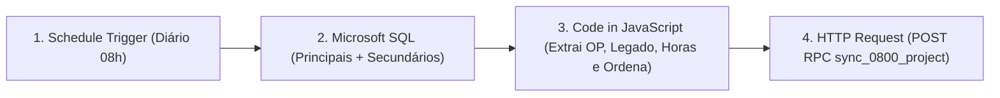

# 🚀 Guia Passo a Passo (Node por Node): Automação 0800 — Sistemas Principais, Produtos Secundários, Horas e Sistema Legado

Este manual explica **exatamente o que alterar manualmente em cada um dos 4 nós** do seu workflow atual no **n8n** (`Criação de Projetos Siplan HUB - 0800`) para que ele capture:
1. Os **Sistemas Principais** (`Orion TN`, `Orion PRO`, `Orion REG`, `WebRI`);
2. Os **14 Produtos Secundários Oficiais** (`Livro Caixa Web`, `SGA`, `Library`, `Cartório On Hand`, `e-Recepção`, `CIAF`, `Image`, `Image PRO`, `e-Qualificação`, `Orion Caixa`, `Orion CartFLOW`, `Orion Connect`, `Orion Editor` e `Orion GED`);
3. As **Horas Vendidas/Contratadas** (`sold_hours`) e o **Sistema Legado** (`legacy_system`), eliminando a necessidade de preenchimento manual no HUB.

> [!IMPORTANT]
> **Onde mora a inteligência e como é resolvido o "Trâmite 4" que chega dias depois?**
> A solução é composta por 3 camadas coordenadas:
> 1. **No Nascimento do Projeto (n8n às 08h):** O n8n já extrai o **Sistema Legado** pelo título do chamado (ex: `+ Conversão WebTD`) e as **Horas** caso já estejam presentes no trâmite inicial.
> 2. **Na Chegada do Trâmite Comercial (Trâmite 4 via Supabase Trigger):** Quando o comercial (Soraya/Camila) lança o Trâmite 4 no Ellevo dias depois com `Horas vendidas de Implantação: 80 horas`, o `vm-worker` sincroniza o trâmite e um **Trigger automático no Postgres (`trg_sync_project_commercial_data`)** atualiza o projeto no Siplan HUB na hora em background, sem exigir nenhuma intervenção sua!
> 3. **Na Interface do HUB (Aba Informações Gerais e Edição):** Se você abrir o projeto no HUB, haverá um assistente visual abaixo do campo Legado:
>    - Se o 0800 tiver os dados: card de 1 clique `Encontrado no Trâmite 4 do 0800: 80h • WebTD [Aplicar ao Projeto]`.
>    - Se o comercial ainda não postou o trâmite: aviso discreto `Aguardando informações de Legado e Horas nos Trâmites do chamado do 0800`.

---

## 📋 Visão Geral dos 4 Nós do Fluxo



---

## 🛠️ Passo a Passo Manual — Nó por Nó

### Nó 1: `Schedule Trigger` (Mantenha como está)
- **Trigger Rules:** `Days` / `Trigger at Hour: 8` (`08:00` todos os dias).

---

### Nó 2: `Microsoft SQL` (`UNION ALL` unificando Collation SAP `CP850` + Ellevo `CP1`)
1. Abra o nó **`Microsoft SQL`** no seu workflow atual.
2. Mantenha sua credencial atual (`Microsoft SQL account`, com `Request Timeout` em `60000`) e **Operation:** `Execute Query`.
3. O conteúdo do campo `Query` é exatamente este:

```sql
WITH principais AS (
  SELECT 
    NomeCliente, 
    NumeroChamado, 
    Software, 
    NumeroPedidoVenda, 
    TituloChamado, 
    descricaotramite, 
    ResponsavelAtividade, 
    EtapasProjeto, 
    DataPedidoVenda,
    ROW_NUMBER() OVER (
      PARTITION BY NumeroChamado 
      ORDER BY DataPedidoVenda DESC
    ) AS rn
  FROM plataformaellevo..vw_2026_PROCESSO_VENDA_FATURAMENTO_ITEM_ATIVIDADES 
  WHERE DataPedidoVenda >= '2026-09-10 00:00:00' 
    AND Software IS NOT NULL 
    AND TituloChamado IS NOT NULL
    AND Software IN ('OrionTN', 'OrionPRO', 'OrionREG', 'Orion TN', 'Orion PRO', 'Orion REG', 'WEBRI', 'WEB RI', 'OrionREG (TDPJ)')
    AND TituloChamado LIKE '%Impla%Treinamento%'
),
secundarios AS (
  SELECT
    c.NomeCliente,
    c.NumeroChamado,
    c.Software,
    c.SolTitulo AS TituloChamado,
    c.ResponsavelChamado AS ResponsavelAtividade,
    c.StatusChamado AS EtapasProjeto,
    c.DataAberturaChamadoComHoras AS DataPedidoVenda,
    ROW_NUMBER() OVER (
      PARTITION BY c.NumeroChamado
      ORDER BY c.DataUltimaEdicaoTramite DESC
    ) AS rn
  FROM plataformaellevo.dbo.vw_ChamadosTodosStatus AS c WITH (NOLOCK)
  WHERE c.DataAberturaChamadoComHoras >= CONVERT(datetime, '2026-09-10T00:00:00', 126)
    AND c.Software IS NOT NULL
    AND c.SolTitulo IS NOT NULL
    AND LTRIM(RTRIM(c.Software)) IN (
      'LCW', 'Livro Caixa Web', 'LCX - Livro Caixa',
      'SGA',
      'Library',
      'Cartório On Hand', 'On Hand',
      'e-Recepção',
      'CIAF',
      'Image', 'IMG', 'ImagePRO', 'Image PRO',
      'e-Qualificação',
      'Caixa', 'Orion Caixa', 'OrionCaixa',
      'Orion CartFLOW', 'OrionCartFLOW', 'CartFLOW',
      'Orion Connect', 'OrionConnect',
      'Editor', 'Orion Editor', 'OrionEditor',
      'GED', 'Orion GED', 'OrionGED'
    )
    AND (
      c.SolTitulo LIKE '%Impla%Treinamento%'
      OR c.SolTitulo LIKE '%Configura%Treinamento%'
      OR c.SolTitulo LIKE '%Treinamento%'
      OR c.SolTitulo LIKE '%Instala%'
      OR c.SolTitulo LIKE '%Configura%'
    )
)
SELECT 
  p.NomeCliente COLLATE database_default AS NomeCliente,
  p.NumeroChamado COLLATE database_default AS NumeroChamado,
  p.Software COLLATE database_default AS Software,
  CAST(p.NumeroPedidoVenda AS varchar(50)) COLLATE database_default AS NumeroPedidoVenda,
  p.TituloChamado COLLATE database_default AS TituloChamado,
  CAST(p.descricaotramite AS nvarchar(max)) COLLATE database_default AS descricaotramite,
  p.ResponsavelAtividade COLLATE database_default AS ResponsavelAtividade,
  p.EtapasProjeto COLLATE database_default AS EtapasProjeto,
  p.DataPedidoVenda
FROM principais p
WHERE p.rn = 1

UNION ALL

SELECT 
  s.NomeCliente COLLATE database_default AS NomeCliente,
  s.NumeroChamado COLLATE database_default AS NumeroChamado,
  s.Software COLLATE database_default AS Software,
  NULL AS NumeroPedidoVenda,
  s.TituloChamado COLLATE database_default AS TituloChamado,
  NULL AS descricaotramite,
  s.ResponsavelAtividade COLLATE database_default AS ResponsavelAtividade,
  s.EtapasProjeto COLLATE database_default AS EtapasProjeto,
  s.DataPedidoVenda
FROM secundarios s
WHERE s.rn = 1;
```

---

### Nó 3: `Code in JavaScript` (Extração de OP, Legado, Horas e Ordenação)
1. Abra o nó **`Code in JavaScript`**.
2. Confirme que **Mode** está em `Run Once for All Items` e **Language** em `JavaScript`.
3. **Substitua todo o conteúdo** pelo código abaixo:

```javascript
const normalizeText = (val) =>
  String(val || '')
    .normalize('NFD')
    .replace(/[\u0300-\u036f]/g, '')
    .toLowerCase()
    .replace(/[^a-z0-9]+/g, ' ')
    .trim();

const isLikelyPrimary = (tituloNorm, softwareNorm) => {
  const match = tituloNorm.match(/\bimpla[a-z]{2,10}\s+(?:e\s+|de\s+|configuracao\s+e\s+)?treinamento\b(.*)$/);
  if (!match) return false;
  const subject = (match[1] || '').trim() || tituloNorm;
  if (/\b(siplan\s*ia|inteligencia\s*artificial|bi\s*report|nfse|nfs\s*e|web\s*rc|modulo\s*ia|rotina)\b/.test(tituloNorm)) {
    return false;
  }
  if (/\b(orio?n\s*(tn|notas|tabelionato|pro|protesto|reg|registro)|web\s*ri)\b/.test(subject)) {
    return true;
  }
  if (!(match[1] || '').trim() && /\b(orion\s*(tn|pro|reg)|web\s*ri)\b/.test(softwareNorm)) {
    return true;
  }
  return false;
};

const itemsByTicket = new Map();

for (const item of $input.all()) {
  const dados = item.json;
  const rawTicket = dados.NumeroChamado ?? dados.numerochamado;
  if (!rawTicket) continue;

  const ticketNum = String(rawTicket).trim();
  if (!ticketNum || itemsByTicket.has(ticketNum)) continue;

  const titulo = String(dados.TituloChamado || dados.titulochamado || dados.TITULOCHAMADO || '').trim();
  const tituloNorm = normalizeText(titulo);
  if (!/\b(impla[a-z]{2,10}|configura[a-z]{2,10})\s+(?:e\s+|de\s+|configuracao\s+e\s+)?treinamento\b/.test(tituloNorm)) continue;
  if (/\bpos\s+impla/.test(tituloNorm)) continue;

  const rawSoftware = String(dados.Software || dados.software || '').trim();
  const softwareNorm = normalizeText(rawSoftware);

  // 1. Extração do Número da OP
  let opNumber = null;
  const opMatch = titulo.match(/\bOP:?\s*([\d\/]+)/i);
  if (opMatch && opMatch[1]) {
    const cleanNumber = opMatch[1].replace(/\D/g, '');
    const parsedOp = parseInt(cleanNumber, 10);
    if (!Number.isNaN(parsedOp) && parsedOp > 0 && parsedOp <= 2147483647) {
      opNumber = parsedOp;
    }
  }

  // 2. Extração do Pedido de Venda
  let salesOrderNumber = null;
  if (dados.NumeroPedidoVenda) {
    const cleanSales = String(dados.NumeroPedidoVenda).replace(/\D/g, '');
    const parsedSales = parseInt(cleanSales, 10);
    if (!Number.isNaN(parsedSales) && parsedSales > 0 && parsedSales <= 2147483647) {
      salesOrderNumber = parsedSales;
    }
  }

  const tramiteDesc =
    dados.descricaotramite ||
    dados.DescricaoTramite ||
    dados.Descricaotramite ||
    'Sem descrição';
  const responsavel =
    dados.ResponsavelAtividade ||
    dados.responsavelatividade ||
    'Não atribuído';
  const etapas =
    dados.EtapasProjeto ||
    dados.etapasprojeto ||
    'Sem etapas definidas';

  // 3. Extração Inteligente de Sistema Legado (do Título ou Atividade)
  let legacySystem = null;
  const legTitleMatch = titulo.match(/\+\s*Convers[ãa]o(?:\s+de\s+Bases?(?:\s+de\s+Dados)?(?:\s+e\s+Imagens)?)?\s*[:\-]?\s*([A-Za-z0-9_\-\.\s]+?)(?:$|[\n\r<])/i);
  if (legTitleMatch && legTitleMatch[1]) {
    legacySystem = legTitleMatch[1].trim().replace(/\s+/g, ' ');
  }

  // 4. Extração Inteligente de Horas Vendidas (da Descrição do Trâmite, se já presente)
  let soldHours = null;
  const hoursMatch = String(tramiteDesc).match(/Horas vendidas[^:\n\r<]*:\s*([0-9]+(?:[.,][0-9]+)?)\s*h/i);
  if (hoursMatch && hoursMatch[1]) {
    const parsedHours = parseFloat(hoursMatch[1].replace(',', '.'));
    if (!Number.isNaN(parsedHours) && parsedHours > 0) {
      soldHours = parsedHours;
    }
  }

  const primaryPriority = isLikelyPrimary(tituloNorm, softwareNorm) ? 0 : 1;

  itemsByTicket.set(ticketNum, {
    _sortPriority: primaryPriority,
    payload: {
      p_ticket_number: ticketNum,
      p_client_name: String(dados.NomeCliente || dados.nomecliente || '').trim(),
      p_system_type: rawSoftware || 'Não informado',
      p_sales_order_number: salesOrderNumber,
      p_op_number: opNumber,
      p_titulo_chamado: titulo || 'Título não preenchido no 0800',
      p_descricao_tramite: String(tramiteDesc),
      p_responsavel_atividade: String(responsavel),
      p_etapas_projeto: String(etapas),
      p_project_leader: 'Bruno Fernandes',
      p_sold_hours: soldHours,
      p_legacy_system: legacySystem
    }
  });
}

return Array.from(itemsByTicket.values())
  .sort((a, b) => a._sortPriority - b._sortPriority)
  .map((entry) => ({ json: entry.payload }));
```

---

### Nó 4: `HTTP Request` (Manter endpoint atual + ativar Batching)
1. Abra o nó **`HTTP Request`**.
2. **Configurações:**
   - **Method:** `POST`
   - **URL:** `https://okvufcwkophaadttmjwa.supabase.co/rest/v1/rpc/sync_0800_project`
   - **Send Body:** `true` | **Body Content Type:** `JSON` | **Specify Body:** `Using JSON`
   - **JSON:** `={{ $json }}`
3. Em **Options** (no final do nó):
   - Confirme que **Batching** está ativo:
     - **Items per Batch:** `1`
     - **Batch Interval (ms):** `50`

---

## 🎯 Como Funciona em Tempo Real:

1. **Quando o chamado é aberto (Trâmite 1):**
   - O n8n roda às 08h e cria o projeto no Siplan HUB.
   - Se o título tiver `+ Conversão WebTD`, o campo **Sistema Legado** já nasce preenchido.
   - O campo **Horas** fica aguardando.
   - No modal do projeto (aba *Informações Gerais*), aparece o aviso suave:
     > `🕒 Aguardando informações de Legado e Horas nos Trâmites do chamado do 0800`

2. **Quando a Soraya/Camila inclui o Trâmite 4 (dias depois):**
   - O `vm-worker` sincroniza o novo trâmite no Supabase.
   - O trigger automático `trg_sync_project_commercial_data` detecta o texto `Horas vendidas de Implantação: 80 horas`.
   - O projeto no HUB é **automaticamente atualizado para 80h**!

3. **Se você estiver com o projeto aberto no HUB:**
   - Logo abaixo de *Legado*, o assistente exibirá o botão de 1 clique:
     > `✨ Encontrado no Trâmite 4 do 0800: 80h • WebTD [Aplicar ao Projeto]`
   - Clicando em **Aplicar**, o projeto é atualizado imediatamente!

---

## 🧪 Como Testar no n8n

1. No n8n, abra o workflow e clique em **`Test workflow`**.
2. Verifique no Node 3 (`Code in JavaScript`) se os campos `p_sold_hours` e `p_legacy_system` foram incluídos no payload JSON.
3. No Node 4 (`HTTP Request`), todas as requisições retornarão `200`/`204`.
4. Clique em **`Save`** no canto superior direito do n8n para manter em produção!
